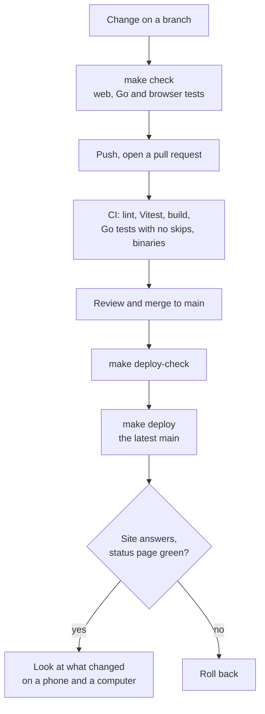
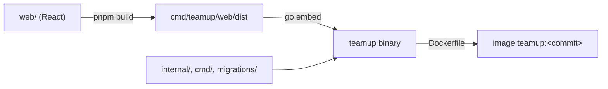

# Build and deploy

How a change gets from your machine to the live server, and back if it has to.
Setting up a server for the first time is [DEPLOYMENT.md](DEPLOYMENT.md); this page assumes one exists.

## The flow



| Step | Command | Changes anything? |
| --- | --- | --- |
| Check everything locally | `make check` | No |
| See what is on the server | `make deploy-check` | No |
| Deploy the latest `main` | `make deploy` | Yes: backs up, builds, migrates, restarts |
| Roll back to an earlier commit of `main` | `make deploy ARGS="--ref <commit>"` | Yes |
| Move to a new address | `make deploy ARGS="--domain new.example.com"` | Yes, and gets a certificate |

## What gets built

TeamUp ships as **one Go binary with the web app compiled into it**, and in production as one Docker image holding that binary.



| Build | Command | Notes |
| --- | --- | --- |
| Binary | `make build` | Builds the web app, then the server, into `bin/teamup` |
| Image | `docker build -t teamup:$(git rev-parse --short HEAD) .` | What the server runs; `scripts/deploy.sh` builds it on the server |
| Binaries for Linux amd64 and arm64 | `make build-all` | |

Two things are fixed at build time and not at run time:

- **The web app**, because it is embedded. Changing a `.tsx` file means a new binary or image.
- **`VITE_LIVEKIT_URL`**, where browsers connect for calls. In production nginx serves LiveKit under `/livekit` on the same address, so it is left empty there; the test build sets it from `web/e2e/test-services.env`.

The migrations are in the binary too: `teamup migrate up` applies them, and in production a short-lived `migrate` container runs it before the server starts.
If a migration fails the server does not start, so a half-migrated database never serves traffic.

## Continuous integration

`.github/workflows/ci.yml` runs on every pull request to `main` and every push to `main`:

| Job | What it checks |
| --- | --- |
| Frontend | ESLint, Vitest, and the production build, which is also the type check |
| Lint (Go) | gofmt, `go vet`, golangci-lint on new code |
| Test (Go) | Every Go test against real Postgres, Redis, MinIO and LiveKit; fails if any test skipped or if tests went missing |
| Build | The binary for linux/amd64 and linux/arm64, then starts it as a smoke test |

CI does not run the browser tests, because they need LiveKit's webhooks to reach the server; `make e2e` is how they run, and `make check` includes them.
CI also does not deploy.
A pushed `v*` tag runs `release.yml`, which publishes an image to `ghcr.io`; no tag has been pushed yet.

**Only `main` is deployed.**
Work happens on branches and reaches the server by being merged to `main` and pushed.
`scripts/deploy.sh` deploys `main` as it is on GitHub, and refuses any commit that is not on it, so what runs is always something everybody can see.

## Deploying

### Once, on your machine

```bash
cp .deploy.env.example .deploy.env      # never committed; .gitignore has it
```

Fill in who to ssh in as and the key.
If your network's IPv6 route to the server is unreliable, set `TEAMUP_DEPLOY_IPV4=1`.
Then `make deploy-check` should print the server's current image and address.

### Every time

```bash
# after the change is merged to main and pushed
make deploy-check
make deploy
```

What `scripts/deploy.sh` does:

1. Fetches `main` from GitHub and takes the **committed** tree of its latest commit, or of the earlier commit of `main` given with `--ref`; a commit that is not on `main` is refused, and nothing uncommitted is ever deployed.
2. Checks the server looks like a TeamUp install.
3. Copies the tree over, keeping the server's `.env`, `certs/`, `backups/` and `backup.sh`.
4. Runs `./backup.sh` first if the server has one, unless you pass `--no-backup`.
5. Builds the image `teamup:<commit>` on the server, which takes a few minutes on a small VM.
6. Starts it: migrations first, the server only if they pass, then restarts nginx so it reads any new config.
7. Waits for the server to report healthy, then checks `/`, `/healthz` and `/api/status` answer over HTTPS.

The long part runs on the server under `nohup`, so a dropped ssh connection does not stop a deploy halfway.
Its log is `/tmp/teamup-deploy.log` on the server.

### What people notice

The site is unavailable for about 15 to 20 seconds while the containers restart, and everybody's live connection drops and comes back by itself.
Open tabs are never reloaded; each offers **A new version of TeamUp is available** once nobody in that tab is in a call.
A deploy that recreates LiveKit's container ends calls in progress; one that only changes TeamUp does not.

### After deploying

- The status page, `https://<address>/status`, says everything is working.
- Sign in, and use what changed, on a phone and on a computer.
- For a migration, `docker compose logs migrate` on the server ends `version <old> -> <new>`.

### A new address

A server without a fixed IP (an Elastic IP on AWS, or your own domain) gets a new public address every time it is stopped and started.
TeamUp, its certificate and LiveKit all need to know the address, so:

```bash
make deploy ARGS="--domain <new address>"
```

That also gets a certificate with certbot, installs it, points TeamUp and LiveKit at the new address, and removes the old certificate's renewal.
With no domain of your own, `<a>-<b>-<c>-<d>.sslip.io` resolves to the IP `a.b.c.d` and can get a certificate.
Everybody signs in again at the new address.
A fixed address avoids all of this.

## Rolling back

Every deploy leaves the previous image on the server; `docker images teamup` lists them.
Do not run `docker image prune -a` on the server, because it deletes them.

**If the bad version added no migration**, point back at the previous image:

```bash
cd /opt/teamup
sudo sed -i 's/^TEAMUP_IMAGE=.*/TEAMUP_IMAGE=teamup:<previous commit>/' .env
sudo docker compose up -d
```

**If it added migrations**, the old version refuses to start on the newer database, on purpose.
Either step the migrations back with the new image first, or restore the backup taken before the deploy.
[DEPLOYMENT.md, Rolling back](DEPLOYMENT.md#rolling-back) has both, tested, and what each loses.
Read the `.down.sql` files before running them.

Or deploy the previous commit forward again: `make deploy ARGS="--ref <previous commit>"` works when no migration is involved.

## Rules that keep this safe

- The repository is public: no server address, key or `.env` value in any commit, issue or pull request.
  `.deploy.env` is ignored for that reason.
- Tag images by commit and never deploy `latest`, so you always know what is running and what to go back to.
- Back up before anything with a migration; `scripts/deploy.sh` does it when `backup.sh` exists.
- Secrets are entered on the server or in the app's own settings (for example Organization, Email), never pasted into chat, tickets or commits.
