# Onboarding

Everything a new developer needs, in the order they need it.
By the end of the first hour you should have TeamUp running, the tests passing, and know where a change goes and how it reaches production.

| Read next | When |
| --- | --- |
| [ARCHITECTURE.md](ARCHITECTURE.md) | Before your first change: how a request, a message and a call move through the code |
| [BUILD-AND-DEPLOY.md](BUILD-AND-DEPLOY.md) | Before you ship: from a merged change to the live server, and back |
| [DEPLOYMENT.md](DEPLOYMENT.md) | Setting up a server for the first time, backups, certificates |
| [`.scratch/`](../.scratch) | What is being built and why: tickets, decisions, progress |

## The flow, on one page

```mermaid
flowchart LR
  A[Clone] --> B["./setup.sh<br/>./start.sh"]
  B --> C[Wizard in the browser]
  C --> D[make test-services]
  D --> E[Pick a ticket in .scratch]
  E --> F[Branch]
  F --> G[Test first,<br/>then the change]
  G --> H[make check]
  H --> I[Commit and pull request]
  I --> J[CI green, review, merge]
  J --> K[make deploy]
  K --> L[Check the live site]
```



## 1. Tools

| Tool | Version | Check with | Why |
| --- | --- | --- | --- |
| Git | any recent | `git --version` | |
| Docker | with Compose v2 | `docker compose version` | Postgres, Redis, MinIO, LiveKit and Mailpit run as containers |
| Go | 1.25 or newer | `go version` | The server |
| Node.js | 20 or newer | `node --version` | The web app |
| pnpm | 9 | `pnpm --version` | Owns `web/pnpm-lock.yaml`; `npm install -g pnpm@9` |

You need nothing else on the machine: no local Postgres, no local Redis.
`psql` is optional; `make test-db` uses it, and `scripts/test-services.sh` does not.

Use pnpm 9 for anything that changes `web/pnpm-lock.yaml`.
The Docker build installs with pnpm 9 and `--frozen-lockfile`, so a lockfile written by another major version can break the server build even though it works on your machine.

## 2. Run it

```bash
git clone https://github.com/himanshu-kr-jha/teamup.sh.git
cd teamup.sh
./setup.sh      # checks tools, picks free ports, writes .env with real secrets, builds
./start.sh      # starts everything and prints the address
```

Open the address it prints, usually http://localhost:8080.
The first page is the setup wizard: it creates your organization and your owner account.
There are no default passwords.

| Command | What it does |
| --- | --- |
| `./start.sh` | Start the backing services and the server |
| `./start.sh --lan` | The same, reachable from a phone on your Wi-Fi |
| `./stop.sh` | Stop the containers |
| `./reset.sh --yes` | Delete all local data and start again from the wizard |
| `./setup.sh --check` | Say what is missing and change nothing |

**Working on the web app with instant reload.**
Keep the server running, then in another terminal:

```bash
cd web && pnpm install && pnpm dev     # http://localhost:3000, proxies /api and /ws to :8080
```

The server embeds the web app it was built with, so after `pnpm dev` work, `make build` before testing on :8080.

**Calls on a phone or another computer** need HTTPS, because browsers only allow the camera and microphone on a secure page or on localhost.
Use `./start.sh --lan` on the same network for the rest, or deploy to a server for calls.

## 3. Find your way around

| Path | What is there |
| --- | --- |
| `cmd/teamup/` | The binary: configuration, wiring every service together, the router, migrations command, graceful shutdown |
| `internal/<area>/` | One package per area. `routes.go` is the HTTP surface, `<area>.go` the rules and SQL, `*_test.go` beside them |
| `internal/testsupport/` | Database fixtures for tests |
| `pkg/protocol/` | The WebSocket message types, shared with nothing else on purpose |
| `migrations/` | Numbered SQL, each with an `.up.sql` and a `.down.sql` |
| `web/src/features/<area>/` | The pages and components for one area |
| `web/src/shared/` | The API client (`api/client.ts`), UI primitives, hooks, theme and branding |
| `web/e2e/` | Browser tests, their helpers, and the scripts that run them |
| `scripts/` | `test-services.sh` and `deploy.sh` |
| `docker-compose.yml` | The development stack `./setup.sh` starts |
| `docker-compose.prod.yml`, `nginx.conf` | Production, see DEPLOYMENT.md |
| `.scratch/<feature>/` | The issue tracker: `spec.md` with numbered decisions, `issues/NN-*.md`, `progress.md` |

A REST request goes nginx, then `cmd/teamup` router, then `internal/auth` middleware, then `internal/<area>/routes.go`, then the service.
A chat message goes the same way and then out to everyone else over the WebSocket hub.
ARCHITECTURE.md walks through both with line numbers.

## 4. The tests

There are three layers, and a change is not finished until all three pass.

| Layer | Command | Runs against | Roughly |
| --- | --- | --- | --- |
| Web app | `make test-web` | Nothing; ESLint, TypeScript and Vitest | 15 seconds |
| Go | `make test-go` | Real Postgres, Redis, MinIO and LiveKit in containers | 3 minutes |
| Browser | `make e2e` | The real binary on the real stack, driven by Playwright and Chromium | 15 minutes |
| All of it | `make check` | Starts the services, then all three | 20 minutes |

Once, before the first run:

```bash
make test-services                       # starts teamup-cal-test-* containers on 127.0.0.1:554xx
cd web && npx playwright install chromium && cd ..
```

The test services are separate from `./setup.sh`'s stack and never touch your local data.
`scripts/test-services.sh status` says what is running and `scripts/test-services.sh down` removes them.

Things worth knowing:

- **A Go test that needs the database skips without it.**
  A suspiciously fast green run tested nothing; CI refuses any run with a skip.
  Always run Go tests through `make test-go`, which points them at the test services.
- **After adding a migration**, run `scripts/test-services.sh migrate`, or every database test fails on a missing column.
- **One browser spec:** `make e2e ARGS="e2e/meetings.y-more.spec.ts"`, or one test by name: `make e2e ARGS='-g "month"'`.
- **A failing browser test** leaves a screenshot and a trace in `web/test-results/`; `npx playwright show-trace <path>/trace.zip` replays it.
  The server under test logs to `/tmp/teamup-e2e-server.log`; `E2E_LOG_LEVEL=debug make e2e ARGS=...` makes it say more.
- The test browser's microphone plays `web/e2e/fixtures/speech.wav` and its camera is Chromium's test pattern, so calls, recordings and the note-taker all have something to hear and see.
- Browser specs share one seeded organization and run in file order, one at a time.
  A test that changes something global, such as the organization's colour, puts it back in `afterAll`.
- `WEBHOOKS NEVER ARRIVED` means the LiveKit test container posts to a different port than the server listens on; `scripts/test-services.sh down` then `up` fixes it.

## 5. Making a change

1. **Find or write the ticket** in `.scratch/<feature>/issues/`, and read the decisions in that feature's `spec.md`.
   A choice that later work depends on becomes a numbered decision there.
2. **Branch** from the branch being worked on, named for what it does: `fix/forwarded-files-404`, `feat/month-view`.
3. **For a bug, reproduce it first in a browser test**, the way somebody using TeamUp would meet it, and watch it fail.
   Then fix it, and watch the same test pass.
4. **For a feature, test what a person can do**, not how the code is arranged.
   Anything scoped to an organization gets a test with a second organization in it, because a missing `org_id` filter passes every single-organization test.
5. **Run `make check`.**
   Fix any lint error, failure or flaky test you meet, even one you did not cause.
6. **Look at it.**
   Open the pages you changed at phone width (375 or 390 pixels) and on a computer, in light and dark.
   Anything that looks off is a bug, related to your change or not.
7. **Commit** with a conventional prefix and a subject that says what changed for the person using TeamUp:
   `feat: forward messages, month view, profile pictures` or `fix: keep the open conversation's badge at zero`.
   No co-author or tool trailers.
8. **Record it**: a comment in the ticket saying what was verified and what was not, and a line in `progress.md`.
9. **Open a pull request** describing the problem as well as the change.

### Recipes

**A migration.**
`make migrate-create`, then write both files.
The `.down.sql` must undo the `.up.sql` and keep existing rows wherever it can.
Add a test in `cmd/teamup/migrate_test.go` that goes up, down and up again over real rows, and never assert that your migration is the newest one.

**An API endpoint.**
Register it in the area's `routes.go`.
Take the organization from the session (`callerOrg`), never from the request.
Errors go through `httpx.Error`, which turns `pkg/errors` codes into statuses; something the caller may not see is a 404, not a 403.
Add the call to `web/src/shared/api/client.ts`.

**A page.**
A folder under `web/src/features/`, a route in `web/src/app/router.tsx`, and server state through TanStack Query.
A query key that other pages also use, such as `['channels']`, must be read the same way everywhere.

**A WebSocket event.**
The type goes in `pkg/protocol/messages.go`, the broadcast in the service, and the listener in the page through `useWebSocket().on`.

### Conventions

- Comments say why, and what would go wrong otherwise; the code already says what.
- Markdown: one sentence per line, and no em dash characters.
- Never edit a `CHANGELOG.md` or a generated file by hand.
- The repository is public.
  Server addresses, keys, `.env` values and anything from `.deploy.env` never go into a commit.
- Prefer quality, simplicity and maintainability over saving development time.

## 6. Shipping it

Read [BUILD-AND-DEPLOY.md](BUILD-AND-DEPLOY.md).
In short: merge, then `make deploy-check`, then `make deploy`, then look at the live site.

## When something is wrong

| Symptom | Fix |
| --- | --- |
| `pattern all:web/dist: no matching files found` | The server embeds the web app: `make build-frontend` |
| `.env not found` | `./setup.sh` |
| A port is taken | `./setup.sh --force` picks free ones (it also replaces the auth secret, which signs everybody out locally) |
| Database tests fail on a missing column | `scripts/test-services.sh migrate` |
| Go tests pass in two seconds | They skipped; use `make test-go` |
| `ERR_PNPM_UNEXPECTED_STORE` | `node_modules` was installed by another pnpm version; delete `web/node_modules` and `pnpm install` with pnpm 9 |
| The page is blank after a change | You are on :8080 with an old build: `make build` and restart, or use `pnpm dev` on :3000 |
| Camera or microphone refused | Not HTTPS and not localhost; see above |
| `WEBHOOKS NEVER ARRIVED` in a browser test | `scripts/test-services.sh down && scripts/test-services.sh up` |
